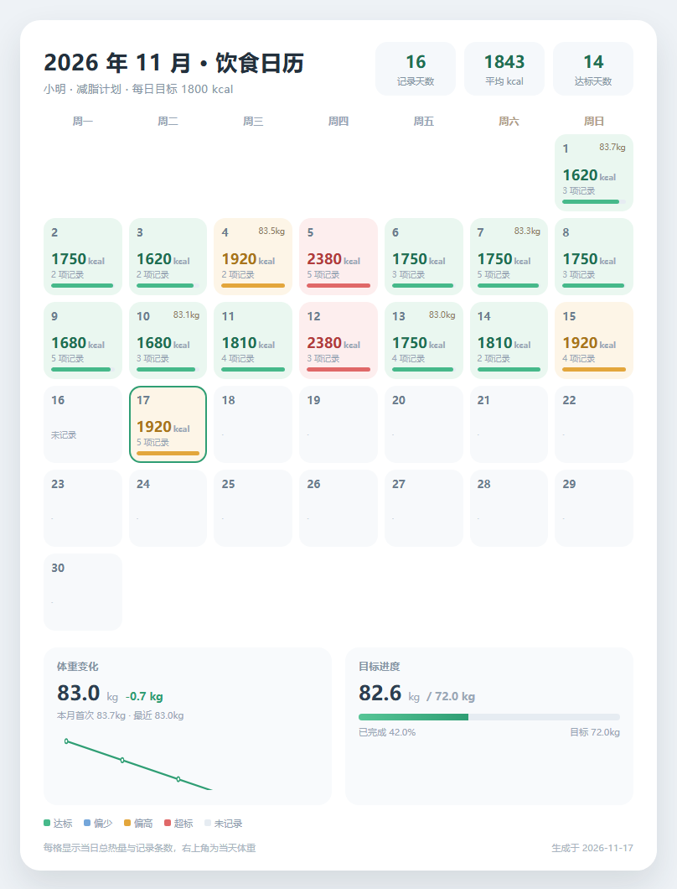

# 热量管家 · AstrBot 插件

[](https://github.com/AstrBotDevs/AstrBot)
[]()
[](LICENSE)

把「算热量」藏进聊天里。

用户不用打开 App、不用背指令，随口说「早饭两个包子一杯豆浆」「今天 68.5」，
AI 就会建档、记录、换算份量、算热量、查营养，并在真该提醒的时候提醒一句。

两条硬规则：

- **只在私聊生效** —— 群聊里不响应指令、不注入状态、不调用工具，等于不存在
- **从不主动发消息** —— 没有每日问候、没有定时推送；只有你先开口，它才会回应

---

## 它解决什么问题

市面上的热量 App 都需要「主动打开 → 搜索 → 选择 → 填份量」，坚持三天就放弃了。
这个插件把记录成本降到「说话」：

| 用户说的话 | 插件做了什么 |
| --- | --- |
| 身高175 体重82 今年28，男的，想三个月减到72 | 建档 → 算 BMR/TDEE → 给每日热量与蛋白目标，并提示计划是否激进 |
| 早饭两个包子一杯豆浆 | 换算成 200g + 250ml → 记录 → 报热量、蛋白、还剩多少额度 |
| 中午点了份黄焖鸡米饭 | 库里没有 → AI 联网确认营养 → 自动存入个人食物库 → 记录 |
| 这个月我吃了多少 | 日历：每天热量、是否达标、当天体重、月均、体重变化 |
| 我还能吃什么 | 按剩余热量和剩余蛋白配一餐（食物 + 克数 + 估算热量） |
| 今天68.5 | 记一次体重 → BMI、周趋势、目标进度、预计达成时间 |

---

## 功能清单

**建档与代谢**
- 身高 / 体重 / 年龄（或出生年，自动随年份推算）/ 性别 / 活动量
- 目标：减脂 / 维持 / 增重，目标体重 + 计划天数
- Mifflin-St Jeor 算 BMR，活动系数算 TDEE，按缺口给每日热量
- 安全下限保护（女 1200 / 男 1500 kcal，且不低于 BMR×0.85），目标过于激进时自动放缓并说明
- 缺口的可行性判断、健康体重区间（BMI 18.5–23.9）、过低目标体重提醒

**饮食记录**
- 一次记多种食物，支持「碗 / 个 / 份 / 杯 / 两 / 片 / 把」等量词自动换克
- 内置 **221 条**常见中式食物：主食、畜禽肉、水产、蛋、豆制品、奶、蔬菜、水果、坚果、油脂调味、饮品、常见菜品、快餐零食
- 食物库没有的：AI 联网查营养后入库（`log_estimated_food`），并写进个人库，下次直接说名字
- 记录按餐次归类（早/午/晚/加餐），自动按时间排序，可撤销
- 饮水、运动（MET 表估算消耗）也能记

**预设**
- 预设食物：自定义食物 + 每 100g 营养 + 常用份量（如「一碗 ≈ 180g」）
- 预设食谱：一整餐的固定搭配，一句话记整餐（「减脂早餐」）

**营养分析（26 项）**
热量、蛋白质、脂肪、碳水、膳食纤维、饱和脂肪、胆固醇、
钠、钾、钙、镁、磷、铁、锌、硒、
维 A、维 D、维 E、维 K、B1、B2、烟酸、B6、B12、维 C、叶酸

- 对照《中国居民膳食营养素参考摄入量（2023）》与膳食指南成人值，按性别区分（如铁 男12/女18mg）
- 蛋白质 / 脂肪 / 碳水的目标由体重与热量目标动态计算，不是固定值
- **按进度折算**：上午只看「到现在应该吃到多少」，不会因为没吃晚饭就判你营养不良；21 点后按全天标准判
- 缺口会换算成具体食物：不是「缺钙」，而是「缺 468mg，可以 300ml 牛奶 + 一块豆干」
- 超标会给出针对性建议（钠偏高少酱料、饱和脂肪偏高少油炸……）
- 供能比、食物多样性（种类数 / 类别数）、三餐分布、深夜进食、饮水都会检查
- 0–100 营养评分

**体重与日历**
- 只在真正称重的日子记录，不制造虚假数据
- BMI、累计变化、14 天线性趋势（kg/周）、目标进度条、按趋势预计达成天数
- 文字日历：逐日热量 + 达标色块 + 当天体重
- 图片日历（`/饮食日历`）：月历格子 + 当月统计 + 体重折线 + 目标进度



**不打扰原则**
- 没有任何定时问候、日报、周报，不主动发起对话，不催促记录
- 只在你说话之后，若真的出现「热量超标 / 关键营养缺口大 / 吃得过少」，在回复里顺带补一句
- 同一用户 4 小时内最多提醒一次；觉得多余可以关掉 `passive_hint`

---

## 安装

1. 把整个 `astrbot_plugin_calorie_coach` 目录放进 AstrBot 的 `data/plugins/`
2. 重启 AstrBot，或在 WebUI 插件页重载
3. 进入插件配置，按需调整（默认即开即用）
4. **私聊**机器人说话即可，不需要任何初始化指令

> 群聊里插件完全不工作：不回复指令、不记录、不参与对话。这是刻意的设计，不是故障。

> 图片日历依赖 AstrBot 的 `html_render`（默认走 Playwright）。没装渲染依赖也不影响其他功能，日历会自动退回文字版。

---

## 怎么用

### 第一次：像聊天一样建档

```
用户：我175，82公斤，28，男的，想三个月瘦到72
AI ：记下了。你的基础代谢大约 1779 kcal，日常消耗 2446 kcal，
     按每天 642 kcal 缺口规划，每天吃 1800 kcal、蛋白 131g 比较合适，
     这样 120 天左右能到 72kg。先说今天吃了什么吧。
```

### 日常：说就行

```
用户：早饭两个肉包一杯豆浆
AI ：记了 3 样，早餐 614 kcal，蛋白 30g。今天还剩 1186 kcal，
     蛋白还差 101g，午饭可以安排点鸡胸或牛肉。

用户：中午黄焖鸡米饭
AI ：这个不在常见食物库里，我按一份 500g 的黄焖鸡米饭（约 620 kcal）记了，
     蛋白 32g。今天已经 1234 kcal 了，晚餐清淡点，多来点绿叶菜。

用户：今天81.6
AI ：记下了。BMI 26.6，比上次轻 0.4kg，近两周平均每周 -0.98kg，
     按这个速度大概 71 天到 72kg。
```

### 指令（可选，不想打字时用）

| 指令 | 作用 |
| --- | --- |
| `/热量` | 今日热量与三餐明细、营养概览、补餐建议 |
| `/营养` | 26 项营养素对照表 |
| `/饮食日历 [2026-11]` | 日历图（不填参数为当月） |
| `/体重 [68.5]` | 有数字则记录，无数字看最近 10 次与趋势 |
| `/目标` | 档案、代谢、目标进度 |
| `/食谱` | 我的预设食物与食谱 |
| `/记录 米饭 1碗 午餐` | 手动快速记录（AI 不可用时的兜底） |
| `/热量帮助` | 使用说明 |

> 所有指令只在私聊有效，群里发了不会有任何反应。

---

## 配置项

| 配置 | 默认 | 说明 |
| --- | --- | --- |
| `enable` | 开 | 总开关，关掉后不记录、不注入对话 |
| `passive_hint` | 开 | 在你自己的消息下面顺带补一句营养提醒 |
| `calendar_image` | 开 | `/饮食日历` 输出图片，关掉走文字 |
| `timezone` | Asia/Shanghai | 留空用 AstrBot 全局时区 |
| `extra_prompt` | 空 | 追加给 AI 的额外要求（称呼、语气等） |
| `default_activity` | light | 新用户默认活动量 |

没有任何推送配置项 —— 这个插件没有能力主动给你发消息。想看总结就自己问，或发 `/热量`、`/营养`、`/饮食日历`。

---

## 数据与隐私

- 全部数据存在 `data/plugin_data/astrbot_plugin_calorie_coach/`，JSON 明文，方便备份和迁移：
  - `users.json` 档案
  - `records.json` 每日饮食、饮水、运动
  - `weights.json` 称重历史
  - `presets.json` 个人食物与食谱
- 不联网上传任何数据；联网只发生在 AI 查未知食物营养时（走你配置的模型）
- 想清空某个用户：直接在 JSON 里删掉对应 uid 的键即可

---

## 判定规则（想调的话看这里）

- **BMR**：`10×体重 + 6.25×身高 − 5×年龄 + (男 5 / 女 −161)`
- **TDEE**：BMR × 活动系数（久坐 1.2 / 轻度 1.375 / 中等 1.55 / 高 1.725 / 极高 1.9）
- **目标热量**：TDEE − 缺口；缺口优先按「目标体重差 × 7700 ÷ 计划天数」，超过 1000 则限到 1000
- **蛋白质**：减脂 1.6 / 增肌 1.8 / 维持 1.2 g/kg；BMI≥28 时按理想体重折算，避免高估
- **脂肪**：25% 热量（不低于 0.6g/kg）；**碳水**：剩余热量
- **单日判定**：不足 <80%，严重不足 <50%，达标 80–120%，偏高 120–150%，过量 >150%（或超 UL）
- **钠/饱和脂肪/胆固醇**：只看是否超上限（钠 2000mg ≈ 5g 盐，饱和脂肪 22g，胆固醇 500mg 宽松参考）
- **没有 UL 的维生素矿物质**（钾、镁、维 K、B1/B2/B12 等）：只判断不足，吃多了不算问题
- **营养评分**：缺口与超标只对重点营养素扣分并设上限，避免一两项就把分数打到 0

参考值为成人通用值，孕期、哺乳期、疾病状态（肾病、糖尿病等）需以医生意见为准 —— 插件不做医疗建议。

---

## 扩展食物库

`presets/foods.json` 是纯 JSON，可直接加：

```json
{
  "name": "自家卤牛肉",
  "cat": "畜禽肉",
  "alias": ["卤牛肉"],
  "nut": [180, 26, 8, 2, 0, 900, 300, 15, 25, 200, 3.2, 5.0, 8, 0, 0, 0.5, 0, 0.05, 0.2, 3.5, 0.3, 1.0, 0, 5, 3.0, 80],
  "portions": [["一小碟", 80], ["一份", 150]]
}
```

`nut` 顺序（每 100g 可食部）：
`kcal, 蛋白质, 脂肪, 碳水, 膳食纤维, 钠mg, 钾mg, 钙mg, 镁mg, 磷mg, 铁mg, 锌mg, 硒μg, 维A μgRAE, 维D μg, 维E mg, 维K μg, B1 mg, B2 mg, 烟酸 mgNE, B6 mg, B12 μg, 维C mg, 叶酸 μgDFE, 饱和脂肪 g, 胆固醇 mg`

更简单的办法：直接在对话里说「把这个存进我的食物库」，让 AI 用 `save_food_preset` 写进个人库。

---

## 目录结构

```
astrbot_plugin_calorie_coach/
├── main.py                 插件主类：注册工具、注入提示词、指令、定时推送、日历出图
├── metadata.yaml
├── _conf_schema.json
├── presets/foods.json      内置食物营养库（221 条）
├── templates/calendar.html 日历图片模板（Jinja2）
├── core/
│   ├── nutrition.py        26 项营养素定义与参考值、向量运算
│   ├── foods.py            食物库加载、模糊检索、份量换算
│   ├── body.py             BMR/TDEE/目标热量/体重趋势/进度
│   ├── analysis.py         摄入汇总、达标判定、缺口、评分、配餐
│   ├── suggest.py          「缺什么吃什么」的食物换算
│   ├── service.py          业务编排（工具与指令共用）
│   ├── store.py            JSON 持久化
│   ├── report.py           文本报告与日历视图
│   └── util.py             日期/餐次/文案工具
├── tools/                  16 个 LLM 工具（档案、饮食、预设、报告）
├── docs/preview.png        日历效果图
└── scripts/                离线自测脚本（不参与运行）
```

---

## 开发者：离线自测

```bash
python scripts/gen_foods.py        # 重新生成食物库
python scripts/selftest.py         # 核心计算链路（无需 AstrBot）
python scripts/stub_e2e.py         # 用桩模块跑通 16 个工具与全部指令
python scripts/preview_calendar.py # 生成日历预览 HTML
```

`stub_e2e.py` 会用最小桩模拟 AstrBot 的 `FunctionTool` / `filter` / `Star`，
真实调用 `tool.call(context, **kwargs)`，覆盖建档 → 记录 → 未知食物 → 营养报告 → 体重 → 食谱 → 日历 → 钩子 → 指令 → 落盘全链路。

---

## 常见问题

**Q：食物找不到怎么办？**
直接告诉 AI 那是什么（品牌、份量），它会联网确认营养后存进你的个人库。之后直接说名字就行。

**Q：热量数字准吗？**
内置库是常见食物成分表的近似值，外卖菜品按典型配比估算，误差通常 ±10–20%。它适合做趋势管理，不适合精确科研。

**Q：会不会每条消息都被塞进热量提醒？**
不会。对话注入只是让 AI「知道现状」，提醒有 4 小时冷却，且只在真有缺口/超标时触发。嫌吵可以关掉 `passive_hint`。

**Q：群里 @ 它 / 发指令为什么没反应？**
插件只在私聊工作，这是刻意限制：群聊里不注入状态、不调用工具、不回复指令，避免健康数据被围观。想让某个功能进群，得先改 `main.py` 里的 `is_private()` 和各工具的 `guard_private()`。

**Q：会不会每天来问候我、催我记录？**
不会。没有任何定时任务，也没有主动发消息的能力。你不说话，它就一直安静。

**Q：`/饮食日历` 没出图？**
说明 AstrBot 的渲染环境没装好，会自动退回文字版；也可以把 `calendar_image` 关掉。

**Q：换机器人 / 换平台，数据还在吗？**
在。数据按平台用户 ID 存，同一平台同一账号不变。跨平台迁移需要手动改 `users.json` 的 uid 键。

**Q：能多人用吗？**
可以，每个用户独立档案、记录、体重与预设 —— 但都发生在各自和机器人的私聊里。
